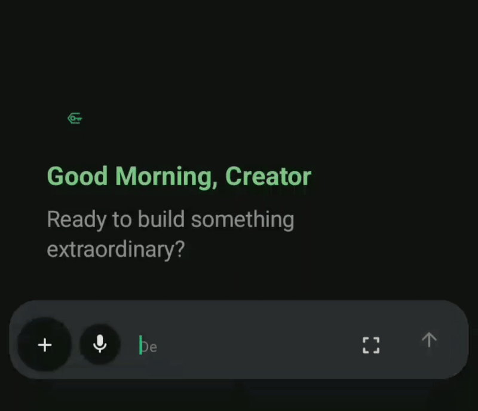

  
  

  <code>ＣＩＰＨΞＲ</code>

### [~] whoami

I'm a developer and security researcher based in Ethiopia.

I don't use a traditional desktop setup. Almost all of my coding, testing, and security research happens directly on my Android phone. By rooting my daily driver and heavily relying on Termux, native Linux environments, and shell scripts, I've turned my mobile device into a complete workspace.

Working this way started out of necessity, but it pushed me to understand how the os works under the hood at the kernel level.

### 𝘮𝘺 𝘤𝘶𝘳𝘦𝘯𝘵 𝘧𝘰𝘤𝘶𝘴

I'm currently focused on low level Android hardware manipulation and building tools for physical security assessments. Instead of high level app development, I spend my time interacting directly with the Linux kernel🤌 and writing with ai bridges.

*   **Stack:** `C++` `Kotlin` `Python` `Bash`
*   **Interest:** Hardware Emulation, Kernel Modifications, Red Teaming

 

  

 

### >_ system_metrics

  
  
  

### >_ audio 😚 logs 

  
  
  
    
  
  

 

  
  
  
  
  
  

### [@] comms_link

  &nbsp;&nbsp;&nbsp;&nbsp;

  &nbsp;&nbsp;&nbsp;&nbsp;

  &nbsp;&nbsp;&nbsp;&nbsp;

  

developer org name => find in repo 
